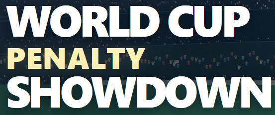

  <!-- BANNER INIZIALE -->
  

    

  

    
    
    
    
  

 

  <h2 style="color: #ffd166; text-transform: uppercase; margin-top: 0;">🌐 ABOUT THIS GAME / INFORMAZIONI SUL GIOCO</h2>
  
<b>[EN]:</b> World Cup Penalty Showdown is an arcade penalty shootout web game inspired by the World Cup, featuring an advanced AI-powered game engine, atmospheric stadium graphics, and procedural audio. <i>"Ninety minutes of pressure from twelve yards. Breathe, pick your corner, charge the shot. One cup. One legend."</i>

  
<b>[IT]:</b> World Cup Penalty Showdown è un videogioco arcade di calci di rigore ispirato alla Coppa del Mondo, caratterizzato da un motore di gioco avanzato basato sull'intelligenza artificiale, grafica atmosferica dello stadio e procedural audio. <i>"Novanta minuti di pressione dal dischetto. Respira, scegli l'angolo, carica il tiro. Una coppa. Una leggenda."</i>

 

  <h3 style="text-transform: uppercase; margin-top: 0; color: #9e0f22;">⚡ CORE HIGHLIGHTS / CARATTERISTICHE PRINCIPALI</h3>
  <ul>
    <li><b>Author / Autore:</b> Giuseppe Caldarola (<i>Seneoo</i>).</li>
    <li><b>Teams & Kit Lab / Nazionali e Personalizzazione:</b> Choose from over 16 official national teams or create a custom club via the Kit Lab, customizing name, code, and kit colors.</li>
    <li><b>Knockout Stages / Fasi a Eliminazione:</b> A tournament structured in 4 knockout stages (Round of 16, Quarterfinals, Semifinals, and Grand Final).</li>
    <li><b>Scalable Difficulty / Difficoltà Scalabile:</b> Three challenge levels (Easy, Expert, and Pro) with responsive CPU reactions and save windows.</li>
    <li><b>Hall of Glory:</b> Dedicated section for unlocked trophies and legendary achievements conquered during the tournament.</li>
  </ul>

 

  <h3 style="text-transform: uppercase; margin-top: 0; color: #ff6f5e;">🎮 GAME CONTROLS / COMANDI DI GIOCO</h3>
  
  
<b>📱 [MOBILE / TOUCH]</b>

  <ul>
    <li><b>Shoot / Tiro:</b> Hold anywhere on the screen to charge power, then release to shoot. / <i>Tieni premuto in un punto libero dello schermo per caricare la potenza e rilascia per calciare.</i></li>
    <li><b>Save / Parata:</b> Tap the side of the goal where you want to dive. / <i>Tocca il lato della porta in cui desideri tuffarti.</i></li>
  </ul>

   

  
<b>⌨️ [PC / KEYBOARD]</b>

  <ul>
    <li><b>Shoot / Tiro:</b> Hold the spacebar to charge power, then release to shoot. / <i>Tieni premuta la barra spaziatrice per caricare la potenza, poi rilasciala per calciare.</i></li>
    <li><b>Save & Position / Parata e Posizionamento:</b> Use the A / D keys or arrow keys to move the goalkeeper. / <i>Usa i tasti A / D o le frecce direzionali per muovere il portiere.</i></li>
  </ul>

 

  <h3 style="text-transform: uppercase; margin-top: 0; color: #ff6f5e;">🔒 LICENSE / LICENZA</h3>
  
<b>[EN]:</b> © Giuseppe Caldarola (Seneoo). All rights reserved. This is a proprietary project. Copying, modifying, distributing, or using this code and its assets in any way, shape, or form is strictly prohibited without explicit written permission.

  
<b>[IT]:</b> © Giuseppe Caldarola (Seneoo). Tutti i diritti riservati. Questo è un progetto proprietario. È severamente vietato copiare, modificare, distribuire o utilizzare questo codice e le relative risorse in qualsiasi modo o forma senza previa autorizzazione scritta.

 

  
<b>🔗 LINKS & CONTACTS</b>

  
  
  

